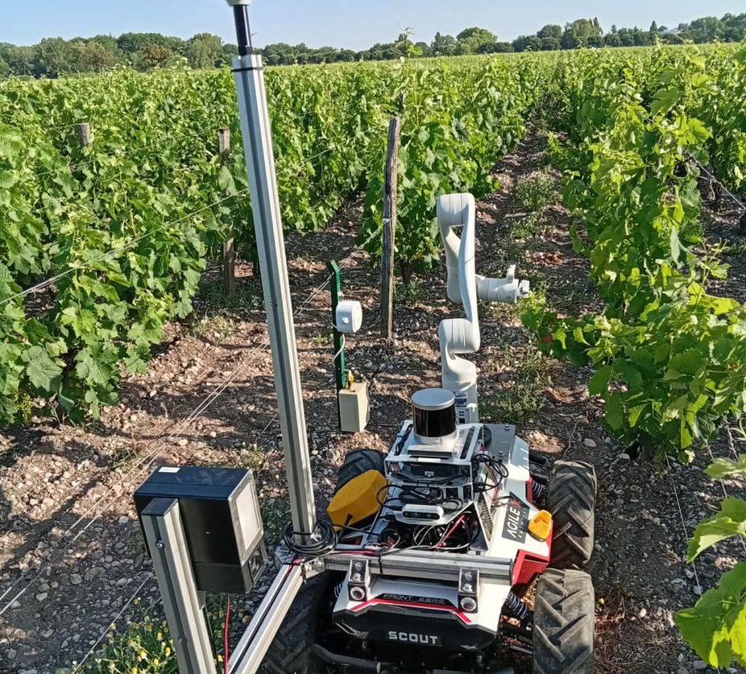
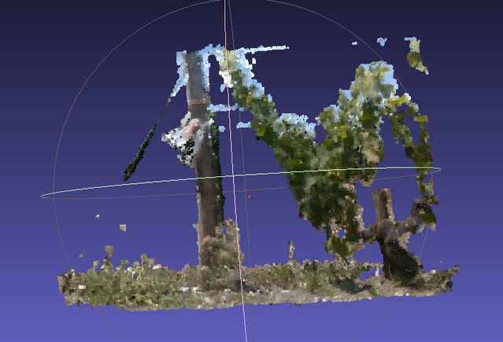
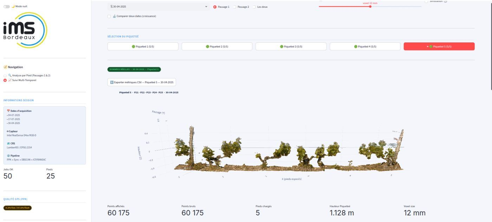
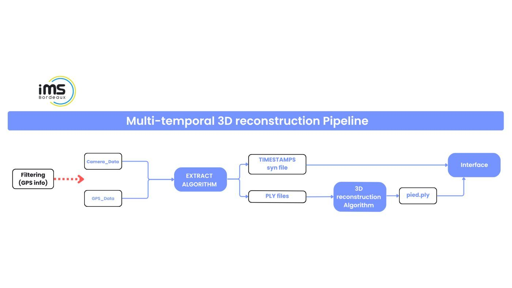

# Reconstruction 3D de pieds de vigne — RGB-D + GNSS RTK/PPK

> Stage ingénieur · Laboratoire IMS Bordeaux, équipe MOTIVE (UMR 5218 CNRS) · mai → septembre 2026
> Projet *Vision 3D Agricole* (France 2030) · *English summary below.*

Un robot de scouting parcourt les rangs de vigne avec une caméra **Intel RealSense D435i** et un GNSS centimétrique **U-blox F9P**. Ce pipeline sélectionne automatiquement les images de chaque pied, reconstruit son **nuage de points 3D** et permet de suivre sa croissance d'une campagne à l'autre.

<p align="center">
  
  
  
</p>

🎥 **Démo (4 min) :** [`media/ims-demo.mp4`](media/ims-demo.mp4)

## Résultats

- **−78 %** de temps d'extraction grâce au portage Python → **C++** multithread (SDK RealSense)
- **25 pieds** reconstruits automatiquement par rang
- Portage **temps réel** validé de bout en bout en simulation



## Pipeline

1. **Synchronisation GNSS ↔ caméra** : post-traitement **PPK** (RTKLIB + stations RGP), correction du bras de levier, suppression des images prises à l'arrêt.
2. **Assignation des images à chaque pied** : rayon adaptatif autour des positions des pieds (shapefile QGIS).
3. **Extraction** : extracteur C++ (`auto_extractor.cpp`) des frames RGB-D depuis les enregistrements.
4. **Reconstruction 3D** (Open3D) : filtrage DBSCAN, recalage RANSAC + ICP par fenêtre glissante.
5. **Méthode SSGLR** : recalage des 5 pieds d'une piquetée guidé par le shapefile + ICP local sous garde-fou.
6. **Supervision** : application **Streamlit** (vues 3D, comparaison entre dates, relance des reconstructions).

## Organisation du dépôt

| Dossier | Version |
|---|---|
| [`offline_per_vine/`](offline_per_vine) | Hors-ligne, reconstruction **pied par pied** + appli Streamlit (`app_v6.py`) + simulateur de scan |
| [`offline_stake_group/`](offline_stake_group) | Hors-ligne, reconstruction **par piquetée** (5 pieds, méthode SSGLR) + appli (`app_piquetee.py`) |
| [`real_time/`](real_time) | Version **temps réel** : streamer, contrôleur de passes, reconstruction à la volée, webapp de visualisation 3D |
| `*/scripts_GPS/` | Correction PPK (RTKLIB), téléchargement des stations RGP, synchronisation GPS |

Chaque dossier contient son `README.txt` (installation détaillée) et son `requirements.txt`.

## Démarrage rapide (version temps réel, sans matériel)

```bash
cd real_time
pip install -r requirements.txt
cmake -S . -B build -DCMAKE_BUILD_TYPE=Release && cmake --build build --parallel
python3 rt_streamer.py                                   # terminal 1
python3 main_rt_controller.py --mode manual --sim-ply    # terminal 2
streamlit run app_RT.py --server.port 8501               # terminal 3
```

Stack : Python · C++ · Open3D · librealsense2 · PCL · RTKLIB · QGIS / shapefile · Streamlit · Ubuntu.

> Les données terrain (enregistrements RealSense, logs GNSS bruts, positions des pieds, nuages de points) ne sont pas publiées.

## Remerciements

Jean-Pierre Da Costa et Mohamed Mabrouk, ainsi que toute l'équipe MOTIVE de l'IMS Bordeaux.

---

### English summary

Software pipeline that rebuilds every single vine in 3D from a scouting robot carrying an Intel RealSense D435i and a centimetre-grade U-blox F9P GNSS: PPK post-processing and camera/GNSS sync, automatic frame-to-vine assignment, multithreaded C++ extractor (−78 % time vs Python), Open3D reconstruction (DBSCAN, RANSAC + ICP), stake-group registration (SSGLR), a Streamlit monitoring app and a real-time version validated in simulation.
